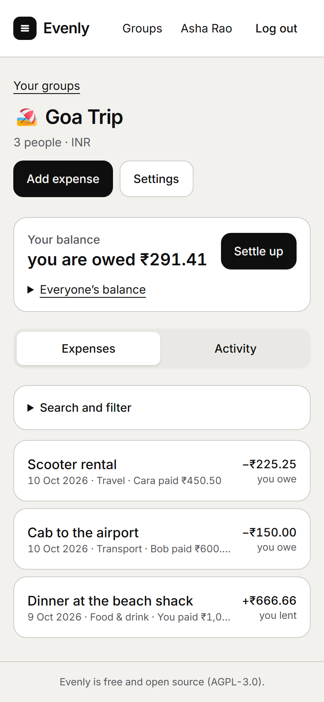
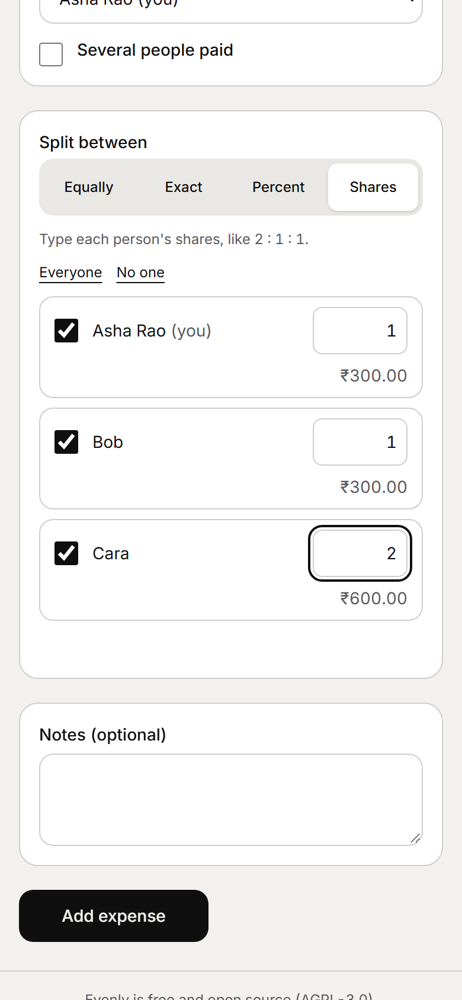
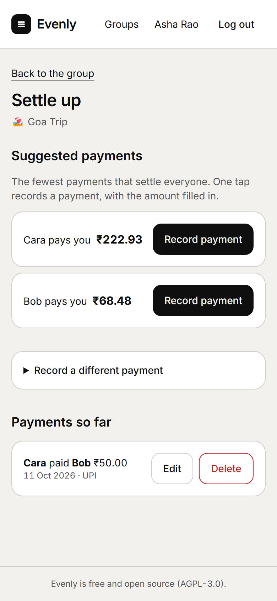
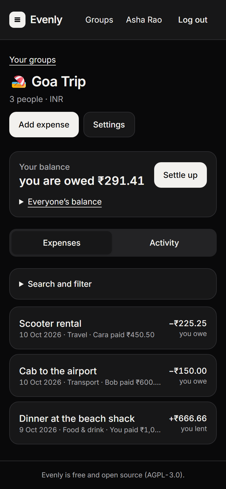

# Evenly

A free, open-source, self-hostable app for splitting shared expenses with friends, flatmates and
travel groups. No paywalls, no limits on groups, expenses or members, and no tracking.

<p>
  
  
  
  
</p>

Evenly is an open-source alternative to apps like Splitwise. It is a clean-room implementation built
from publicly observable behaviour; it is not affiliated with any commercial product. It is the first
project of the Liberated Software initiative.

## What it does

- **Groups and people.** Create groups in any currency, invite people with a link (with an expiry and a
  use limit), or add someone by name before they have an account and let them claim their place later.
  Roles: owner, admin, member.
- **Expenses, to the cent.** One or several payers; split equally, by exact amounts, by percentages or by
  shares. The form shows each person's share as you type, and the split always adds up to the total:
  odd cents are handed out in a fixed, repeatable order. Money is stored as integers, never floats.
- **Balances and settling up.** Per-person balances that always sum to zero; a simplified plan with the
  fewest payments (or the actual pairwise debts, if you turn that off); record a suggested payment with
  one tap. A dashboard totals what you owe and are owed across groups.
- **History you can trust.** An activity feed of every change, soft deletes with restore, and a warning
  (with the differences) if two people edit the same expense at once.
- **Your data.** A CSV export per group whose totals match the balances on screen.
- **Accounts without a mail server.** Email and password; password reset by email if you configure SMTP,
  otherwise by a command the administrator runs.
- **Made for phones first,** works from the keyboard, light and dark themes, no third-party requests.

## Self-host in 2 minutes

You need Docker.

```bash
git clone https://github.com/Vaarun-Kamath/evenly.git
cd evenly
docker compose up -d
```

Open <http://localhost:3000> and create the first account. The bundled Postgres is only reachable from
the app container, and its data lives in the `db-data` volume. The first start takes a couple of
minutes while the image builds.

Release builds are published (for amd64 and arm64) as `ghcr.io/vaarun-kamath/evenly`. With a release
available, `docker compose pull && docker compose up -d` uses that image instead of building one, and
`EVENLY_VERSION=0.1.0` in `.env` pins a version.

### On a public address

Put a reverse proxy (Caddy, nginx, Traefik) in front for HTTPS, and tell Evenly where it lives. In `.env`:

```bash
PUBLIC_URL=https://split.example.com      # the address people type; a sub-path such as https://example.com/evenly works too
TRUST_PROXY=1                             # one proxy in front: trust its X-Forwarded-For
ALLOW_SIGNUPS=invite-only                 # optional: only people with an invitation link can sign up
```

### Configuration

Settings go in a `.env` file next to `docker-compose.yml` (see [`.env.example`](.env.example)). Every value
is checked at startup, and the server exits with a clear message if one is wrong.

| Variable                  | Default                 | What it does                                                                                             |
| ------------------------- | ----------------------- | -------------------------------------------------------------------------------------------------------- |
| `PUBLIC_URL`              | `http://localhost:3000` | The address people use, with any sub-path. Cookies, links in invitations and the Origin check follow it. |
| `APP_PORT`                | `3000`                  | The port Docker publishes (compose only).                                                                |
| `POSTGRES_PASSWORD`       | `lib001`                | Password of the bundled database (compose only). Keep it URL-safe.                                       |
| `DATABASE_URL`            | set by compose          | Postgres connection string, if you use your own database.                                                |
| `ALLOW_SIGNUPS`           | `true`                  | `true`, `false` or `invite-only`. The first account on a new instance can always be created.             |
| `INVITE_DEFAULT_TTL_DAYS` | `7`                     | How long an invitation link lasts by default.                                                            |
| `TRUST_PROXY`             | `false`                 | `false`, `true`, a number of proxy hops, or a list of addresses. Set a hop count behind a proxy.         |
| `TRUSTED_ORIGINS`         | none                    | Extra allowed origins, comma-separated.                                                                  |
| `SESSION_SECRET`          | generated               | At least 32 random characters. When unset, one is generated on first start and kept in the database.     |
| `SMTP_URL`, `SMTP_FROM`   | none                    | Turn on email: password reset by email and invitations by email.                                         |
| `LOG_LEVEL`               | `info`                  | `fatal`, `error`, `warn`, `info`, `debug`, `trace` or `silent`.                                          |
| `EVENLY_VERSION`          | `latest`                | Which published image to use (compose only).                                                             |

### Running it

- **Password reset without email:** `docker compose exec app node dist/cli.js reset-password you@example.com`
  prints a single-use link that works for an hour.
- **Updating:** pull or rebuild, then `docker compose up -d`. Database migrations run automatically at
  startup, under a lock, so several replicas cannot race.
- **Health checks:** `/healthz` (the process is up) and `/readyz` (the database answers and the migrations are applied).
- **Backups:** the database is the only state. Dump it, and keep the dump somewhere else:

  ```bash
  docker compose exec -T db pg_dump -U lib001 -Fc lib001 > evenly-$(date +%F).dump
  ```

  To restore into a fresh, empty database (stop the app first):

  ```bash
  docker compose stop app
  docker compose exec -T db psql -U lib001 -d postgres -c "DROP DATABASE lib001 WITH (FORCE)" -c "CREATE DATABASE lib001 OWNER lib001"
  docker compose exec -T db pg_restore -U lib001 -d lib001 --no-owner --exit-on-error < evenly-2026-10-11.dump
  docker compose up -d
  ```

  `scripts/backup-restore-test.sh` does exactly this on a throwaway stack, and checks that every table,
  the balances and people's logged-in sessions come back unchanged. Test a restore before you need one.

## How it compares

Evenly does the core job of a commercial expense-splitting app, with no caps, and you keep the data. It
does not yet do everything such apps do. Check their current feature lists before choosing.

|                                      | Evenly                                                      |
| ------------------------------------ | ----------------------------------------------------------- |
| Groups, expenses, members            | Unlimited                                                   |
| Split methods                        | Equal, exact, percentage, shares; several payers            |
| Settling up                          | Simplified plan or pairwise; you record payments            |
| Cost                                 | Free; you pay for your own hosting                          |
| Your data                            | On your server; CSV export; open source (AGPL)              |
| Mobile                               | A web app that works well on phones; no native apps yet     |
| Currencies                           | One currency per group today; conversion is planned         |
| Receipts, recurring expenses, charts | Not yet (see the roadmap)                                   |
| Moving money                         | No. Evenly records who paid whom; it does not make payments |
| Email                                | Only if you configure SMTP                                  |
| Running it                           | You: updates, backups and security are yours                |

## Roadmap

After 0.1: expenses in other currencies with free conversion (daily ECB rates, stored on the expense),
charts by category, person and month, recurring expenses, receipt photos (S3-compatible storage),
itemised bills, search across groups, one-to-one expenses outside any group, email digests, an
installable app with offline entry, sign-in with Google or GitHub, passkeys, and translations.
Details are in [`docs/lib-001-split/SPEC.md`](docs/lib-001-split/SPEC.md).

## Develop

You need Node.js 24 (see `.nvmrc`), pnpm 12 (`npm install -g pnpm@12.11.2`) and Docker.

```bash
pnpm install
docker compose -f docker-compose.yml -f docker-compose.dev.yml up -d db   # Postgres on localhost:5432
cp .env.example .env
pnpm dev          # API on :3000, web app on :5173 (proxies /api)
pnpm check        # lint, format check, typecheck, tests (the server's integration tests need the
                  # Postgres above; they create and drop their own databases)
./scripts/smoke.sh  # builds the Docker image and checks it at / and /evenly
./scripts/e2e.sh    # the Playwright scenarios against that image (once: pnpm --filter @evenly/e2e exec playwright install chromium)
./scripts/backup-restore-test.sh  # dumps, drops and restores the database of a throwaway stack
```

Layout: `apps/server` (Fastify API), `apps/web` (React SPA), `packages/core` (pure money and split
logic), `packages/contracts` (zod schemas shared by both), `e2e` (Playwright). Design documents are in
[`docs/`](docs/); decisions that depart from them are in [`docs/adr/`](docs/adr/). See
[CONTRIBUTING.md](CONTRIBUTING.md) and [SECURITY.md](SECURITY.md).

## Licence

[AGPL-3.0-only](LICENSE). If you run a modified version as a public service, you must publish your
changes.
